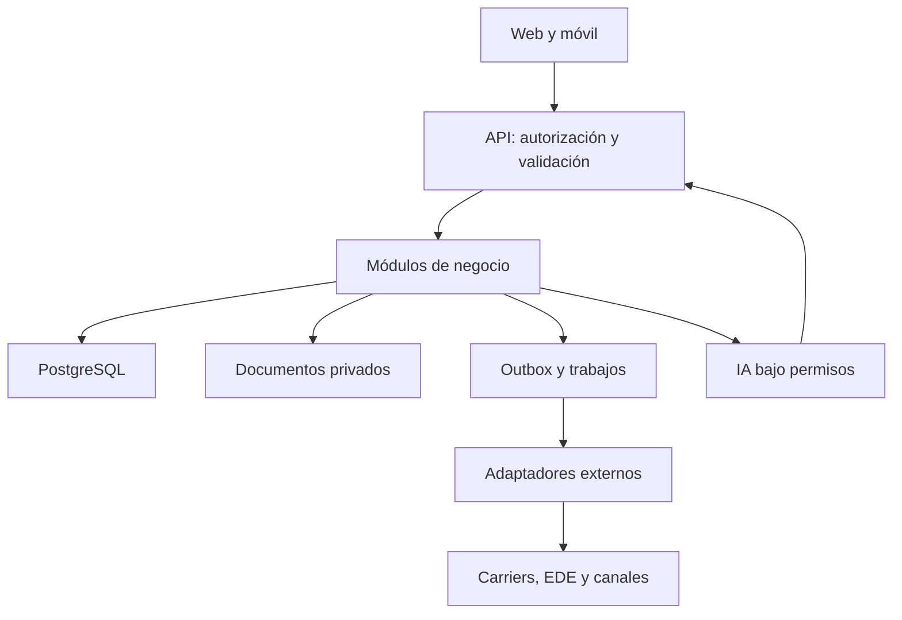

# 04 · Arquitectura propuesta
## Forma inicial
Monolito modular con API, PostgreSQL y trabajadores de tareas. Evitar microservicios hasta que una necesidad medible lo justifique. Módulos: identidad/organizaciones; CRM; cartera; evidencia; finanzas; tareas; comunicaciones; integración; analítica; IA.

## Stack candidato, aún no adoptado
- Next.js/TypeScript para interfaz y API; PostgreSQL para datos.
- Hosting AWS como opción a evaluar por experiencia de Nubelai, sin provisión actual.
- Identidad administrada; almacenamiento de objetos privado; cola y scheduler.
- n8n opcional para orquestar integraciones, nunca como libro financiero ni autoridad de permisos.
- IA reemplazable mediante adaptador; retrieval con filtros del servidor.
Resolver costo, ubicación, acuerdos, operación y soporte antes de elegir servicios.

## Contratos internos
Cada comando identifica actor, organización, operación e idempotency_key. API valida alcance y estado. Persistir cambio y evento outbox en transacción; worker entrega eventos con reintentos limitados y cola de errores. Consumidores idempotentes.
Entidades y eventos tienen IDs propios, timestamp UTC, correlación y versión. Historial externo conserva occurred_at, received_at y fuente.

## Integración
Adaptador por proveedor con esquema canónico, mapeos versionados, sandbox, credenciales privadas y métricas. Webhooks verifican firma y repetición. No aceptar respuesta remota como autorización local.
Errores distinguen validación, permiso, autenticación, indisponibilidad y conflicto. Timeouts no provocan doble inscripción ni doble envío.

## Datos y finanzas
Base relacional transaccional; moneda explícita; importes en unidades menores o decimal exacto según dominio; regla y redondeo versionados. Documentos fuera de base, con metadatos/huella y control de acceso. Búsqueda y exportación usan el mismo alcance que los detalles.

## Entornos
Desarrollo sintético → staging sintético/sandbox → piloto controlado → producción. Separar identidad, secretos y datos. Infraestructura declarativa; copias y restauración probadas. Objetivos de recuperación y carga se acuerdan con Sunshine.

## Decisiones
D01 stack/hosting; D02 alcance/aislamiento; D03 identidad; D04 socio de inscripción; D05 modelo de comisiones; D06 documentos/retención. Pendientes en el registro. Escribir ADR antes de adoptar cada una.
